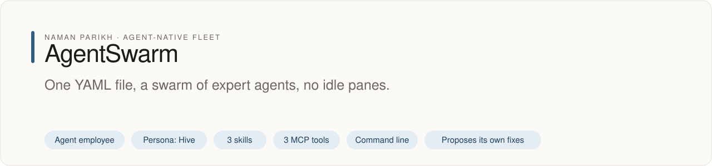
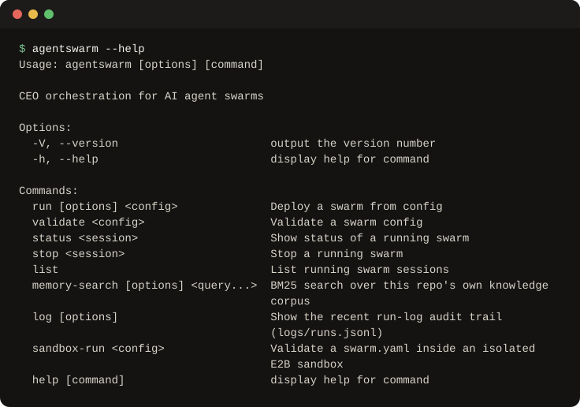

# agentswarm

<!-- fleet:header:start -->
<p align="center"><picture><source media="(prefers-color-scheme: dark)" srcset="assets/banner-dark.svg"></picture></p>

<p align="center">
<a href="https://github.com/naman10parikh/agentswarm/actions/workflows/ci.yml"></a>
<a href="https://github.com/naman10parikh/agentswarm/releases"></a>
<a href="LICENSE"></a>
<a href="#use-it-from-any-coding-agent"></a>
<a href="https://x.com/naman10parikh"></a>
<a href="https://www.linkedin.com/in/naman-parikh1/"></a>
</p>

<p align="center"><a href="#quick-start">Quick start</a> · <a href="docs/README.md">How it works</a> · <a href="AGENTS.md">AGENTS.md</a> · <a href="llms.txt">llms.txt</a> · <a href="skills/">Skills</a> · <a href="https://github.com/naman10parikh/agentswarm/discussions">Discussions</a> · <a href="https://github.com/naman10parikh">All projects</a></p>

**One YAML file, a swarm of expert agents, no idle panes.**

AgentSwarm is an agent employee, a packaged specialist agent with its own skills, memory and tests. It owns one job: dispatch. Its persona is Hive. Coding agents use it through its skills, its MCP server and its command line. A scheduled job runs its evals and proposes fixes. A person makes every change.

_AgentSwarm is part of an agent-native play for agent-native systems that can eventually be recursively self-improving and evolving, operated by agent employees._

<p align="center"></p>
<!-- fleet:header:end -->

agentswarm turns one `swarm.yaml` into a team of coding agents. It opens one tmux pane per role, starts a Claude Code
agent in each, starts a role only when the roles it depends on are done, and writes a live status file. It is for
people and lead agents who want several agents to work through a goal in order without watching every pane.

<!-- fleet:use:start -->
## Use it from any coding agent

**Claude Code**: the plugin brings the skills, sub-agents, hooks and MCP server.

```
/plugin marketplace add naman10parikh/agentswarm
/plugin install agentswarm@agentswarm
```

<details><summary>Its MCP server, Codex, Cursor, Gemini CLI, one skill and the command line</summary>

**Its MCP server**, in any MCP client:

```bash
claude mcp add --transport stdio agentswarm -- npx -y -p github:naman10parikh/agentswarm agentswarm-mcp
codex mcp add agentswarm -- npx -y -p github:naman10parikh/agentswarm agentswarm-mcp
```

Cursor (`.cursor/mcp.json`), Gemini CLI (`.gemini/settings.json`) and most other clients take the same command as JSON:

```json
{
  "mcpServers": {
    "agentswarm": {
      "command": "npx",
      "args": [
        "-y",
        "-p",
        "github:naman10parikh/agentswarm",
        "agentswarm-mcp"
      ]
    }
  }
}
```

**Gemini CLI**: the extension brings the context and the MCP server.

```bash
gemini extensions install https://github.com/naman10parikh/agentswarm
```

**One skill** (3 in all, in [skills/](skills/)), in any agent that reads Agent Skills:

```bash
gemini skills install https://github.com/naman10parikh/agentswarm --path skills/author-swarm
git clone --depth 1 https://github.com/naman10parikh/agentswarm /tmp/agentswarm && cp -r /tmp/agentswarm/skills/author-swarm ~/.claude/skills/
```

**The command line:**

```bash
npx -y -p github:naman10parikh/agentswarm agentswarm --help
```

</details>

Codex, Cursor, OpenCode, GitHub Copilot and other agents read [AGENTS.md](AGENTS.md); Claude Code reads [CLAUDE.md](CLAUDE.md) and Gemini CLI reads [GEMINI.md](GEMINI.md), which import it. [llms.txt](llms.txt) maps every surface for agents that read first.
<!-- fleet:use:end -->

## Quick start

You need Node 18 or newer and tmux.

```bash
# Run it straight from GitHub, nothing installed
npx -y -p github:naman10parikh/agentswarm agentswarm --help

# Or keep a copy: clone, build, and put the commands on your PATH
git clone https://github.com/naman10parikh/agentswarm && cd agentswarm
npm install && npm install -g .
```

Your first swarm:

```bash
agentswarm-sh init                 # writes a starter swarm.yaml: VP Alpha, then VP Beta
agentswarm validate swarm.yaml     # "✓ Config valid", or the exact error
agentswarm run --dry swarm.yaml    # the plan; no tmux session is created
agentswarm run swarm.yaml          # starts VP Alpha, then VP Beta, and follows both to done
```

From another terminal, while it runs:

```bash
agentswarm status swarm-my         # each role: RUNNING, IDLE or DONE
agentswarm list                    # running swarm sessions
agentswarm stop swarm-my           # ends the swarm's tmux session
```

VP Beta starts only after VP Alpha prints `VP Alpha: DONE` on its own line. Edit the prompts in `swarm.yaml` to give
each role real work.

## How it works

You can spawn a grid of Claude Code panes (with [agentgrid](https://github.com/naman10parikh/agentgrid) or raw tmux).
But who decides what each pane works on, keeps the order, and notices when a pane has gone idle? agentswarm is that
CEO layer: it reads a config, starts each role's agent, watches for completion signals, sequences work through
`depends_on`, and writes a live status file, so a multi-agent run is declarative instead of manual.

```
                      ┌──────────────────┐
                      │       CEO        │  reads swarm.yaml
                      │  agentswarm run  │  starts a VP once its depends_on are done
                      └─────────┬────────┘  marks it done on its "{Role}: DONE" line
                                │
          ┌──────────────┬──────┴───────┬──────────────┐
          ▼              ▼              ▼              ▼
   ┌────────────┐ ┌────────────┐ ┌────────────┐ ┌────────────┐
   │VP Research │ │ VP Writer  │ │ VP Editor  │ │VP Distrib. │
   │   pane 0   │ │   pane 1   │ │   pane 2   │ │   pane 3   │
   └────────────┘ └────────────┘ └────────────┘ └────────────┘
```

Each VP runs in its own tmux pane with its own Claude Code. The CEO is the `agentswarm run` process: it polls every
pane for a line that is exactly `{Role}: DONE`, starts a waiting VP once every role in its `depends_on` is done, and
flags a pane idle when it has printed nothing for `idle_timeout` seconds. A prompt reaches the agent as one
single-quoted argument, so shell syntax in it is text and never runs.

### Two ways to run it

| Path | Bin | Needs | When |
| --- | --- | --- | --- |
| **TypeScript** | `agentswarm` | Node 18 or newer, tmux | Default. Waits on `depends_on`, logs every run, has the MCP server. |
| **Bash** | `agentswarm-sh` | bash, tmux, python3 with PyYAML | No build step. Also waits on `depends_on`. Sends only the first five lines of each prompt. |

Both read the same `swarm.yaml`. To put only the bash CLI on your PATH, run `bash install.sh` in a clone: it checks
for bash, tmux and python3, installs PyYAML if it is missing, and writes `~/.local/bin/agentswarm`, a wrapper for
`src/cli.sh`.

### `swarm.yaml` format

```yaml
swarm:
  name: my-swarm # Human-readable name
  session: swarm-my # tmux session name
  poll_interval: 120 # Seconds between CEO status checks
  max_runtime: 180 # Minutes before auto-shutdown
  idle_timeout: 300 # Seconds of no output ⇒ pane marked idle

ceo:
  prompt: |
    You are the CEO. Monitor VPs and coordinate.
  model: opus # Not used: the CEO is the agentswarm process itself, not an agent
  context:
    - CLAUDE.md # Not used either

vps:
  - role: VP Research # Unique role name
    pane: 1 # Pane number
    prompt: |
      Do research. Say "VP Research: DONE" when finished.
    model: sonnet # Passed to claude as --model; leave it out for Claude Code's default
    workdir: .
    depends_on: [] # Roles that must finish before this VP starts
    outputs: # Files this VP produces (advisory)
      - research/output.md
```

Rules:

1. **Role names must be unique** across the swarm.
2. **Completion signal:** each VP must print `{Role}: DONE` on its own line when finished.
3. **Dependencies:** `depends_on` lists role names that must complete first.
4. **Models:** each VP's `model` reaches its agent as `claude --model <value>`, exactly as the file writes it. A VP
   with no `model` gets no flag, so Claude Code uses its default model. A common split: `opus` for strategic work,
   `sonnet` for implementation, `haiku` for simple tasks.

### Commands

| Command | Description |
| --- | --- |
| `agentswarm validate <config>` | Check a config; prints precise errors |
| `agentswarm run --dry <config>` | Preview the deployment without tmux |
| `agentswarm run <config>` | Deploy a swarm and follow it to done |
| `agentswarm status <session>` | Show each VP's progress |
| `agentswarm stop <session>` | Kill a running swarm |
| `agentswarm list` | List active swarm sessions |
| `agentswarm memory-search "<query>"` | BM25 search over this repository's memory and docs |
| `agentswarm log` | The run log: one line per command, in `logs/runs.jsonl` |
| `agentswarm sandbox-run <config>` | Validate an untrusted config inside an E2B microVM (needs `E2B_API_KEY`) |
| `agentswarm-sh init` | Create a starter `swarm.yaml` (bash CLI) |

### Status monitoring

agentswarm tracks each VP as `RUNNING ▶`, `IDLE ⏸` (no output past `idle_timeout`), or `DONE ✓`. Status is also
written to `/tmp/agentswarm-{session}-status.json` for programmatic access:

```json
{
  "timestamp": "2026-03-17T14:30:00Z",
  "session": "swarm-content",
  "vps": [
    { "role": "VP Research", "pane": 1, "status": "done" },
    { "role": "VP Writer", "pane": 2, "status": "running" }
  ]
}
```

### Examples

```bash
agentswarm run examples/content-swarm.yaml   # Research → Writer → Editor → Distribution
agentswarm run examples/oss-pipeline.yaml     # Research → Builder → Docs
```

### Tests and evals

```bash
pnpm install && pnpm build
pnpm test         # vitest: loader, orchestration, memory, run log, signal and quoting
pnpm eval         # every surface, then golden swarms on a private tmux server with stand-in agents, pass^3
```

The golden swarms never touch your own tmux and never call a model. CI runs both on every push and pull request.

### See also

- [agentgrid](https://github.com/naman10parikh/agentgrid): the tmux grid primitives agentswarm deploys onto.
- Built on the Energy agent-native harness formula.

<!-- fleet:anatomy:start -->
## What it is made of

Every project in this fleet is graded on the same 11 harness components and on self-improvement. Each mark is backed by a file you can open.

| Component | Grade | Where |
| --- | --- | --- |
| Identity | ✅ | identity/SOUL.md:1 (Hive; BRAND, HEARTBEAT, bootstrap MEMORY, no template slots) |
| Memory | ✅ | memory/MEMORY.md:1 (about 520 tokens) + BM25 index src/memory-search.ts:2 (agentswarm memory-search) + memory/LEARNINGS.md (10 rules) |
| Skills | ✅ | skills/author-swarm/SKILL.md:1, skills/run-swarm/SKILL.md:1, skills/debug-swarm/SKILL.md:1 |
| Tools/CLIs | ✅ | package.json:6 (bins agentswarm, agentswarm-sh, agentswarm-mcp); src/ceo.ts:333 (--version) |
| Hooks | ✅ | .claude/settings.json:4 (PreToolUse dangerous-command and secret guards, PostToolUse audit log) + hooks/hooks.json:4 (plugin swarm-guard) |
| Sub-agents | ✅ | .claude/agents/swarm-designer.md:1, .claude/agents/swarm-doctor.md:1 (bundled in .claude-plugin/plugin.json) |
| MCPs | ✅ | src/mcp-server.ts:45 (own stdio server, 3 tools; bin agentswarm-mcp) + .mcp.json:3 |
| Dispatch | ✅ | src/ceo.ts:33 (deploy) and src/ceo.ts:181 (depends_on gate); scheduled run .github/workflows/improve.yml:9 |
| Evals | ✅ | eval/run.sh:1 (surfaces 43, golden 10 tasks pass^3) gating CI .github/workflows/ci.yml:38 |
| Observability | ✅ | src/run-log.ts:22 (append-only logs/runs.jsonl, failures included) + status JSON src/ceo.ts:293 + .claude/hooks/audit-log.sh |
| Sandbox/Infra | ✅ | src/sandbox.ts:78 (E2B microVM runs the real loader; e2b dependency package.json) |
| Self-improvement | ✅ | dsip.json:1 (L2) + .github/workflows/improve.yml (nightly loop) + scripts/improve.mjs |

✅ real and tested · 🟡 partial, with the reason in the row · ❌ absent
<!-- fleet:anatomy:end -->

<!-- fleet:footer:start -->
## How it improves itself

It carries its own evals and a self-improvement contract, [`dsip.json`](dsip.json), which says what it may change and how a change is judged. A scheduled job runs its evals and proposes fixes. A person makes every change. Lessons it learns are kept as rules in its memory files.

## Part of a fleet

One of the projects by [Naman Parikh](https://github.com/naman10parikh). Each owns one part of an agent's harness, or of the product around an agent, and all of them follow one standard.

| Related project | What it owns |
| --- | --- |
| [AgentDial](https://github.com/naman10parikh/agentdial) | Identity |
| [WikiMem](https://github.com/naman10parikh/wikimem) | Memory |
| [Skillsmith](https://github.com/naman10parikh/skillsmith) | Skills |
| [Agent Booster](https://github.com/naman10parikh/agent-booster) | Tools / CLIs |
| [Armory](https://github.com/naman10parikh/armory) | MCPs and the component registry |
| [AgentGrid](https://github.com/naman10parikh/agentgrid) | Dispatch |
| [AgentBench](https://github.com/naman10parikh/agentbench) | Evals |
| [AgentMoney](https://github.com/naman10parikh/agentmoney) | Observability |
| [Claude Harness](https://github.com/naman10parikh/claude-harness) | The whole harness, as a template |

## Community

Questions and ideas go to [Discussions](https://github.com/naman10parikh/agentswarm/discussions); bugs go to [issues](https://github.com/naman10parikh/agentswarm/issues/new/choose). Follow the work on [X](https://x.com/naman10parikh) and [LinkedIn](https://www.linkedin.com/in/naman-parikh1/).

## Contributing and security

Read [CONTRIBUTING.md](CONTRIBUTING.md). AI-assisted pull requests are welcome. Report a vulnerability privately, as [SECURITY.md](SECURITY.md) explains.

## Star history

If it is useful to you, a star helps other people find it.

<a href="https://star-history.com/#naman10parikh/agentswarm&Date"><picture><source media="(prefers-color-scheme: dark)" srcset="https://api.star-history.com/svg?repos=naman10parikh/agentswarm&type=Date&theme=dark"></picture></a>

## Contributors

<a href="https://github.com/naman10parikh/agentswarm/graphs/contributors"></a>
<!-- fleet:footer:end -->

## License

MIT, see [LICENSE](LICENSE).
