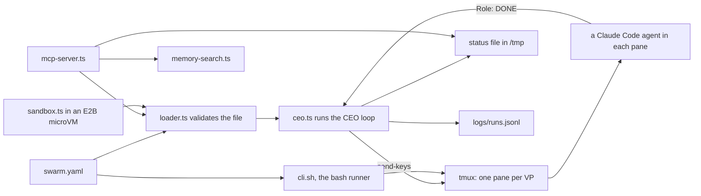

# How AgentSwarm works

AgentSwarm turns one `swarm.yaml` file into a team of coding agents. Each role in the file is a VP: a Claude Code agent in its own tmux pane. tmux is a terminal tool that holds many shell panes in one window. The CEO is the `agentswarm run` process itself. It starts each VP once the roles it depends on are done, and it notices when a VP finishes or goes quiet. AgentSwarm is for people and lead agents who want several agents to work through a goal in order, without watching every pane.

## The parts

The TypeScript command line lives in [src/ceo.ts](../src/ceo.ts). It reads your file through [src/loader.ts](../src/loader.ts), which checks the required sections, unique role names and every `depends_on` entry. The tmux calls sit in [src/tmux.ts](../src/tmux.ts). [src/vp.ts](../src/vp.ts) holds two rules: how a prompt is typed into a pane, and how a finish line is recognised. The prompt travels as one single-quoted shell argument, so `$(...)` or backticks in it never run. A VP counts as done only when one line of its pane reads exactly `{Role}: DONE`.

On every poll the CEO rewrites a status file at `/tmp/agentswarm-<session>-status.json`. Every command also appends one line to `logs/runs.jsonl` through [src/run-log.ts](../src/run-log.ts), failures included. [src/mcp-server.ts](../src/mcp-server.ts) is an MCP server: MCP (Model Context Protocol) is the standard way coding agents call outside tools. It offers three tools, `validate_swarm`, `swarm_status` and `memory_search`. The last is a BM25 keyword search over the repository's own memory and docs, in [src/memory-search.ts](../src/memory-search.ts). [src/sandbox.ts](../src/sandbox.ts) runs the same loader inside an E2B microVM, a small isolated cloud machine, for a file you do not trust. [src/cli.sh](../src/cli.sh) is a second runner in bash. It needs no build step, but it starts every role at once and does not wait on `depends_on`.

## What happens when you run it

1. `agentswarm run swarm.yaml` starts the command line in [src/ceo.ts](../src/ceo.ts). It loads the file with `loadSwarmConfig` from [src/loader.ts](../src/loader.ts). An invalid file stops here, with every error listed.
2. The CEO prints the plan: each role, its model and what it waits for. With `--dry` it stops after the plan and creates nothing.
3. It checks that tmux is installed, ends any old session with the same name, and creates a new one. [src/tmux.ts](../src/tmux.ts) splits one pane per VP and tiles them.
4. Each VP with no dependencies gets its launch command at once. `vpLaunchCommand` in [src/vp.ts](../src/vp.ts) builds `claude --dangerously-skip-permissions '<prompt>'`. That flag means the agent never stops to ask for approval. A VP that must wait shows a waiting line in its pane.
5. Every `poll_interval` seconds, the monitor loop in [src/ceo.ts](../src/ceo.ts) reads the last 30 lines of each running pane. `isDoneSignal` marks a VP done when it finds the finish line. A pane silent for `idle_timeout` seconds is marked idle.
6. When every role a waiting VP depends on is done, the CEO sends that VP its launch command. It checks again five seconds later.
7. After each poll the CEO prints every VP's status and rewrites the status file. The loop ends when every VP is done, or after `max_runtime` minutes.
8. As the process exits, [src/run-log.ts](../src/run-log.ts) appends the command, its arguments, its duration and its outcome to `logs/runs.jsonl`. The tmux session keeps running until you call `agentswarm stop <session>`.

## Extending it

- **A command.** Add a `program.command(...)` block in [src/ceo.ts](../src/ceo.ts). Document it in [AGENTS.md](../AGENTS.md), [README.md](../README.md) and [llms.txt](../llms.txt). The nightly loop in [scripts/improve.mjs](../scripts/improve.mjs) flags any command in `--help` that those files never mention.
- **An MCP tool.** Add its definition to `TOOLS`, plus a handler and a `case` line, in [src/mcp-server.ts](../src/mcp-server.ts). Name the tool in the skill that covers its job, or the nightly loop will propose it.
- **A skill.** Add `skills/<name>/SKILL.md` with `name` and `description` front matter and `## Steps` and `## Output` sections. [eval/surfaces.py](../eval/surfaces.py) checks that shape. The three current skills are in [skills/](../skills/).
- **A sub-agent.** Add a Markdown file with `name` and `description` under [.claude/agents/](../.claude/agents/). List it in [.claude-plugin/plugin.json](../.claude-plugin/plugin.json) so the plugin ships it.
- **A hook.** Put the script in [hooks/](../hooks/) and wire it in [hooks/hooks.json](../hooks/hooks.json). [hooks/swarm-guard.mjs](../hooks/swarm-guard.mjs) is a working example. It blocks `tmux kill-server` and `tmux select-pane`.
- **An eval.** Add a golden task to [eval/golden.sh](../eval/golden.sh) with its `ok` and `bad` helpers. Put any new swarm file in [eval/fixtures/](../eval/fixtures/). Unit tests go in [test/](../test/).

Before you push, run `pnpm build`, `pnpm test` and `pnpm eval`. CI runs the same three steps on every push and pull request, in [.github/workflows/ci.yml](../.github/workflows/ci.yml).

## Questions

**Does it need an API key or cost money?** AgentSwarm itself needs no key. Each VP runs `claude`, so it uses your own Claude Code sign-in and plan. The one command that needs a key is `sandbox-run`, which reads `E2B_API_KEY`.

**Does any data leave the machine?** The command line, the CEO loop, the status file and the run log all stay local. The Claude Code agents it starts talk to their model provider as usual. `sandbox-run` uploads your file, the compiled loader and the `yaml` package to an E2B sandbox.

**How does it improve itself?** Its self-improvement contract, [dsip.json](../dsip.json), declares level L2. At L1, the evals gate every push and pull request. At L2, a nightly workflow, [.github/workflows/improve.yml](../.github/workflows/improve.yml), runs [scripts/improve.mjs](../scripts/improve.mjs). That script compares the live commands and MCP tools with the docs, skills and memory, then writes `logs/proposal.md`. It never edits a tracked file and never merges. A person makes every change.

**How do I run its tests and evals?** Run `pnpm install && pnpm build`, then `pnpm test` for the Vitest unit tests. `pnpm eval` runs [eval/run.sh](../eval/run.sh): a check of every install surface, then real swarms. Those swarms use a private tmux server and a stand-in `claude`, so no model is called. Each task must pass three rounds in a row. You need tmux, Node 18 or newer and Python 3.

**What does it not do?** It does not choose an agent's model. The `model` field shows in the plan and the status file, but the launch command does not pass it. The TypeScript runner validates the `ceo` prompt but starts no separate CEO agent. It does not restart a VP that stalls, it only marks it idle. The bash runner does not wait on `depends_on`.
